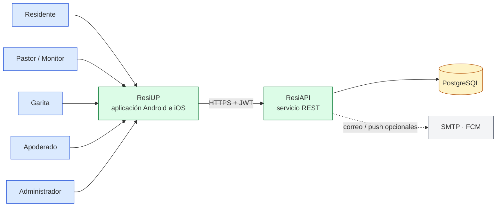
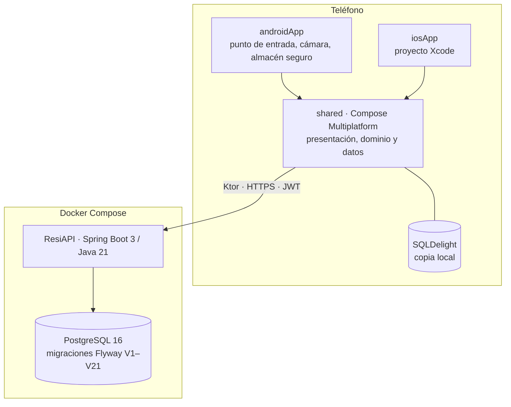
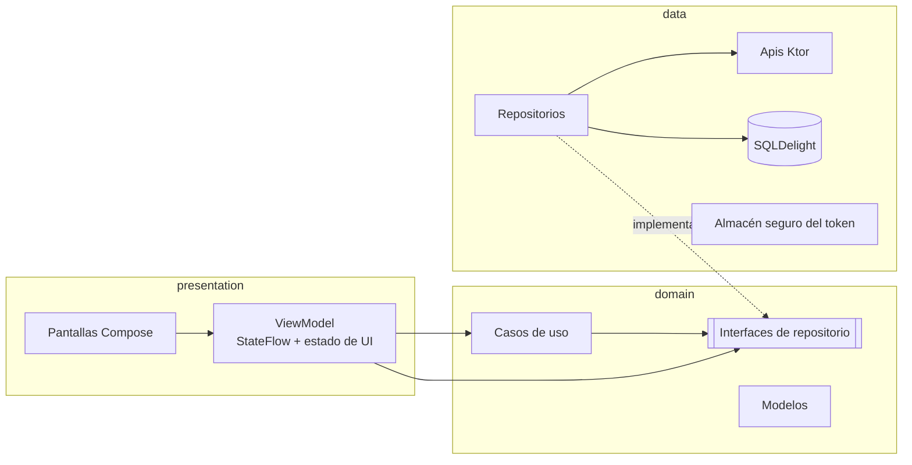
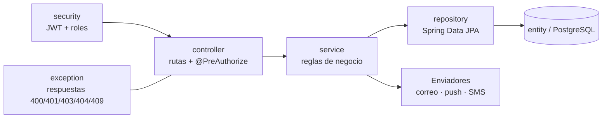

# Arquitectura de ResiUP y ResiAPI

Los diagramas están en Mermaid (se ven en GitHub). Siguen los niveles 1 a 3 del modelo C4.

## Nivel 1 · Contexto

Cinco roles usan la misma aplicación; el rol viaja firmado en el token y decide las pantallas y las rutas permitidas.

## Nivel 2 · Contenedores

| Contenedor | Tecnología | Responsabilidad |
|---|---|---|
| `shared` | Kotlin Multiplatform, Compose, Koin, Ktor, SQLDelight | Toda la lógica y las pantallas |
| `androidApp` / `iosApp` | Android (AAB/APK firmado) / Xcode | Arranque y capacidades nativas por plataforma |
| ResiAPI | Spring Boot, Spring Security (JWT), JPA | Reglas de negocio y roles |
| PostgreSQL | 16 | Datos; el esquema nace solo de Flyway |

## Nivel 3 · Componentes de la aplicación (`shared`)

Reglas de dependencia: `presentation → domain ← data`. El dominio no conoce Ktor, SQLDelight ni Android. Las pantallas no llaman al cliente HTTP: piden datos a un ViewModel o a una interfaz de repositorio del dominio (`AdministracionRepository`, `AccionesPastorRepository`, `ReservasRepository`, `ResidenteRepository`, etc.).

## Nivel 3 · Componentes del servicio (ResiAPI)

## Decisiones

- **Un solo código para Android e iOS** (Kotlin Multiplatform); lo específico (cámara, almacén seguro) entra por interfaces del dominio con implementación por plataforma.
- **Reglas en el servidor**: fechas, horarios, cierres y roles se validan en ResiAPI aunque la interfaz también los muestre.
- **Offline-first**: la interfaz lee de la base local y las operaciones pendientes se suben antes de bajar datos (ver `README.md`). Las acciones de administración y corrección del pastor exigen conexión porque el servidor es la única fuente de verdad.
- **Secretos fuera del repositorio**: clave de firma del JWT y credenciales por variables de entorno; el almacén de claves de Android no se versiona.
